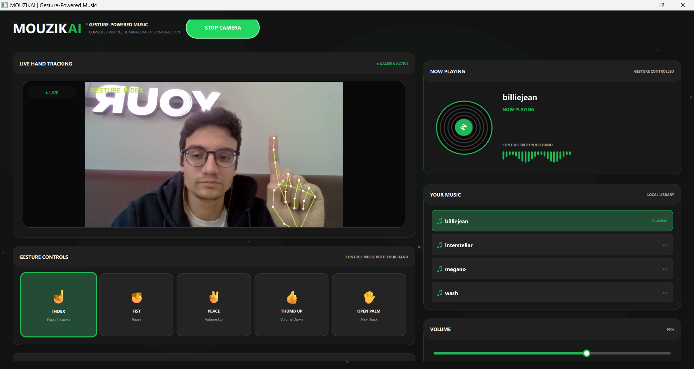
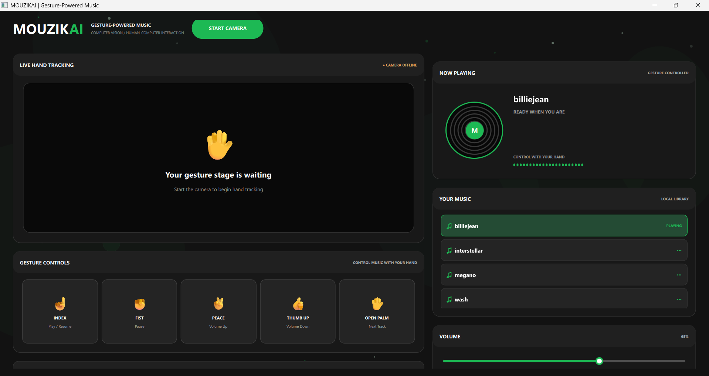

# GestureStage

GestureStage is a webcam-based music controller. It uses hand landmarks to recognise a small set of poses and map them to music-player actions.

## Controls

| Gesture | Action |
|---|---|
| Index finger | Play or resume the selected track |
| Palm | Next track |
| Fist | Pause playback |
| Peace sign | Increase volume |
| Thumb up | Decrease volume |

The desktop interface also provides a local playlist, a play button, track selection and a volume slider.

## How it works

The application uses Google's pretrained MediaPipe Hand Landmarker task. The model detects a hand and returns 21 landmarks for its wrist, thumb and fingers. GestureStage uses those landmarks in a separate geometric classifier. The classifier checks finger joint angles and thumb direction, then maps the resulting pose to a command.

The hand model is pretrained; this project does not train or fine-tune it. The gesture classifier is a set of hand-written geometric rules, not a trained neural network. The current rules are a starting point and can be affected by hand rotation, camera angle, lighting and occlusion.

## Screenshots

### Live Hand Tracking
Real-time hand tracking with MediaPipe, including gesture recognition and visual hand landmarks.



### Dashboard Interface
The MOUZIKAI dashboard in its idle state, displaying the music library, gesture controls, and playback interface.



## Stack

- Python 3.11
- OpenCV
- MediaPipe Tasks
- Pygame
- Tkinter
- Pillow

## Setup on Windows

Create and activate a virtual environment:

```powershell
python -m venv .venv
.\.venv\Scripts\Activate.ps1
```

Install dependencies:

```powershell
python -m pip install --upgrade pip
pip install -r requirements.txt
```

Download Google's Hand Landmarker model and save it as `models/hand_landmarker.task`:

https://storage.googleapis.com/mediapipe-models/hand_landmarker/hand_landmarker/float16/1/hand_landmarker.task

Put audio files you are allowed to use in `assets/music`. MP3, WAV and OGG are supported. Audio and the model file are excluded from Git.

Launch:

```powershell
python app.py
```

Select **Start Camera**. Choose a track from the playlist, then use the gestures above.

## Project structure

```text
GestureStage/
├── app.py
├── requirements.txt
├── README.md
├── models/
├── screenshots/
├── assets/music/
└── src/
    ├── config.py
    ├── gestures.py
    ├── music_player.py
    └── vision.py
```

## Performance and testing

Camera capture and hand tracking run on a background thread so inference does not block the interface. The preview queue keeps the newest frame, and gesture commands require a stable pose before they are sent.

Frame rate, recognition accuracy and command latency have not yet been benchmarked. They should be measured with a labelled test set across different users, lighting conditions, hand orientations and camera distances before making reliability claims.

## Privacy

Camera frames are processed locally. The application does not intentionally save or upload camera footage. Music remains on the user's computer.

## References

- [MediaPipe Hand Landmarker](https://developers.google.com/edge/mediapipe/solutions/vision/hand_landmarker)
- [OpenCV](https://opencv.org/)
- [Pygame](https://www.pygame.org/)
---

© All rights reserved to MAT
